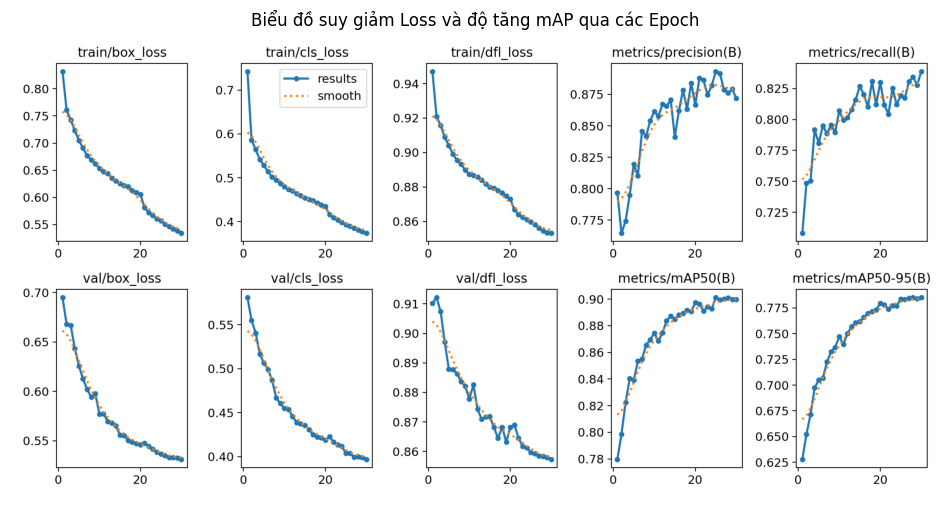

# 🚦 Hệ Thống Giám Sát & Phân Tích Giao Thông Thông Minh (YOLOv8 + ByteTrack)

Giám sát lưu lượng phương tiện thời gian thực: nhận diện xe, đếm theo hướng đi, đánh giá ùn tắc và xuất báo cáo JSON phục vụ tối ưu đèn tín hiệu. Chạy trên Laptop GPU RTX 3050, nguồn hình từ webcam, camera điện thoại hoặc video quay sẵn.

## 📁 1. Cấu trúc dự án

```text
train_model/
├── traffic_monitor/          # Package mã nguồn
│   ├── __init__.py
│   ├── config.py             # Toàn bộ tham số cấu hình
│   ├── processor.py          # Lõi: YOLO + ByteTrack + đếm xe qua vạch
│   ├── drawing.py            # Vẽ vạch, bounding box, quỹ đạo, dashboard
│   ├── exporter.py           # Đánh giá ùn tắc, gợi ý đèn, xuất JSON
│   └── video_source.py       # Mở camera/video, resize khung hình
├── weights/best.pt           # Trọng số mô hình đã train
├── video/                    # Video giao thông quay sẵn
├── logs/                     # JSON báo cáo (tự sinh)
├── docs/                     # Biểu đồ đánh giá mô hình
├── main.py                   # Điểm khởi chạy
├── requirements.txt
└── README.md
```

## 🧠 2. Logic hoạt động

Pipeline 4 bước trên mỗi khung hình:

1. **Detection (YOLOv8n):** nhận diện 4 loại `car`, `motorbike`, `bus`, `truck`.
2. **Tracking (ByteTrack):** gán `track_id` duy nhất cho từng xe, lưu tối đa 30 điểm tâm gần nhất để vẽ quỹ đạo.
3. **Đếm qua vạch:** vạch ngang ảo tại `LINE_Y_RATIO` (mặc định 0.55). Với tọa độ y trước đó và hiện tại của tâm xe:
   - Xuống (A → B): `y_prev < line_y ≤ y_curr`
   - Lên (B → A): `y_prev > line_y ≥ y_curr`

   Mỗi `track_id` chỉ được đếm **một lần** (`counted_ids`).
4. **Ùn tắc & JSON:** dựa trên số xe có mặt cùng lúc: *Thấp* → *Trung bình* (≥ 8) → *Cao* (≥ 15). Báo cáo được xuất mỗi `EXPORT_INTERVAL_SECONDS` giây (mặc định 60) và khi thoát chương trình. Số liệu đếm là **tích lũy** từ lúc chạy.

## 🚀 3. Cài đặt & chạy

```powershell
pip install -r requirements.txt
# GPU RTX 3050:
pip install torch torchvision --extra-index-url https://download.pytorch.org/whl/cu121
```

Chỉnh nguồn video trong `traffic_monitor/config.py`:

```python
VIDEO_SOURCE = 0                                # Webcam laptop
VIDEO_SOURCE = "http://192.168.1.15:8080/video" # Camera điện thoại (IP Webcam / DroidCam)
VIDEO_SOURCE = "traffic_video_1.mp4"            # File trong thư mục video/
```

Chạy:

```powershell
python main.py
```

## 🛑 4. Thoát chương trình

- Nhấn `q` hoặc `ESC` khi cửa sổ video đang được chọn
- Bấm nút `X` của cửa sổ
- `Ctrl + C` trong terminal

Mọi cách thoát đều tự lưu file JSON cuối cùng vào `logs/`.

## 📊 5. Đánh giá mô hình

| Confusion matrix | Kết quả huấn luyện |
|---|---|
|  |  |

## 📝 6. Ví dụ JSON

```json
{
    "timestamp": "2026-10-19T23:55:00",
    "location": "Nut giao thong Da Nang - Camera 01",
    "active_vehicles_in_frame": 9,
    "congestion_status": "Trung binh (Dong duc)",
    "lane_downward": { "direction": "Bac -> Nam (Huong Xuong)", "total_vehicles": 42, "breakdown": { "car": 8, "motorbike": 30, "bus": 1, "truck": 3 } },
    "lane_upward":   { "direction": "Nam -> Bac (Huong Len)",   "total_vehicles": 25, "breakdown": { "car": 5, "motorbike": 18, "bus": 0, "truck": 2 } },
    "ai_traffic_signal_recommendation": "Uu tien tang thoi gian den xanh cho Lan Xuong (+15s den +20s)."
}
```
