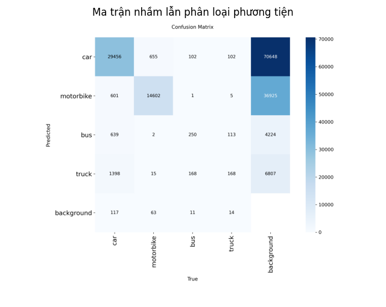

# 🚦 Smart Traffic Monitoring

**Giám sát lưu lượng và gợi ý thời gian đèn xanh cho ngã tư bằng YOLOv8 + ByteTrack.**

Hệ thống mô phỏng một ngã tư bằng **2 camera quay từ phía sau** trên 2 cung đường vuông góc. Ứng dụng desktop nhận diện xe, đếm xe đi ra xa qua vạch, quy đổi sang đơn vị xe máy (PCU), so sánh lưu lượng 2 cung đường và **gợi ý** điều chỉnh thời gian đèn xanh (chỉ gợi ý, không tự đổi đèn). Có đăng nhập, phân quyền Admin/User và thống kê lưu trong SQLite.


## Mục lục
[Tính năng](#tính-năng) · [Cách hoạt động](#cách-hoạt-động) · [Cấu trúc thư mục](#cấu-trúc-thư-mục) · [Cài đặt và chạy](#cài-đặt-và-chạy) · [Cấu hình](#cấu-hình) · [Cơ sở dữ liệu](#cơ-sở-dữ-liệu) · [Kiểm thử](#kiểm-thử) · [Tài liệu](#tài-liệu) · [Bảo mật](#bảo-mật-và-dữ-liệu-nhạy-cảm) · [Hạn chế](#giả-định-và-hạn-chế)

## Tính năng
- Nhận diện và bám vết 4 loại xe: ô tô, xe máy, xe buýt, xe tải.
- Quỹ đạo xe màu **xanh** (đi ra xa, được đếm) và **đỏ** (đi về camera, không đếm).
- Quy đổi PCU, gom mốc 60 giây, so sánh lưu lượng trung bình 3 phút giữa 2 cung đường.
- Gợi ý chia lại thời gian đèn xanh khi một cung đông hơn rõ rệt; đèn giao thông mô phỏng có đếm ngược giây.
- Đăng nhập, phân quyền Admin/User, tab Thống kê (số xe theo loại, biểu đồ PCU theo giờ), tab Quản trị.
- Ghi báo cáo JSON theo ngày và lưu thống kê vào CSDL SQLite.

## Cách hoạt động
1. **Nhận diện và bám vết:** YOLOv8 + ByteTrack, mỗi camera một instance YOLO riêng.
2. **Hướng đi:** theo độ dời của tâm xe: dịch lên là đi ra xa, dịch xuống là đi về camera.
3. **Đếm:** chỉ đếm xe đi ra xa khi cắt vạch, mỗi ID đúng một lần. Vạch đặt theo thang 0–100 (0 = mép dưới khung hình), mặc định 40.
4. **PCU** (1 xe máy = 1): xe máy 1, ô tô 3, tải 5, bus 6.
5. **Gom mốc:** mỗi 60 giây chốt một mốc; lưu lượng so sánh là PCU/phút trung bình của 3 mốc gần nhất.
6. **Gợi ý** khi cung đông hơn từ 30% trở lên và tổng từ 10 PCU/phút trở lên. Thời gian xanh chia theo tỉ lệ PCU, giữ nguyên tổng và chu kỳ, giới hạn 20–45 giây.
7. **Đèn mô phỏng:** 2 đèn ngược pha, chu kỳ mặc định 100 giây (mỗi cung xanh 35, vàng 3, đỏ 62).

## Cấu trúc thư mục

```text
train_model/
├── main.py                       # Điểm khởi chạy: tạo CSDL nếu chưa có, mở cửa sổ đăng nhập
├── requirements.txt              # Danh sách thư viện cần cài
├── README.md                     # Tài liệu này
├── .gitignore                    # Loại trừ khỏi Git: .env, file CSDL, video nặng, cache
├── .env.example                  # Mẫu biến môi trường (được đưa lên Git); sao chép thành .env để dùng
│
├── traffic_monitor/              # Mã nguồn chính
│   ├── __init__.py               # Đánh dấu package, ghi phiên bản
│   ├── config.py                 # TOÀN BỘ tham số (vạch đếm, PCU, ngưỡng gợi ý, đèn, CSDL...), đọc .env
│   ├── processor.py              # YOLO + ByteTrack: nhận diện, xác định hướng, đếm xe qua vạch
│   ├── drawing.py                # Vẽ vạch đếm, khung xe, quỹ đạo xanh/đỏ lên khung hình
│   ├── counter.py                # Bộ đếm tích lũy của một cung đường (theo loại xe và PCU)
│   ├── aggregator.py             # Gom mốc 60 giây, tính PCU/phút trung bình cửa sổ 3 mốc
│   ├── signal_advisor.py         # Công thức gợi ý thời gian đèn xanh (hàm thuần, dễ kiểm thử)
│   ├── signal_controller.py      # Máy trạng thái đèn giao thông mô phỏng, đếm ngược giây
│   ├── camera_worker.py          # Luồng xử lý riêng cho mỗi camera, báo mốc vừa xong cho CSDL
│   ├── video_source.py           # Mở webcam / URL stream / file video, đổi kích thước khung hình
│   ├── exporter.py               # Xuất báo cáo JSON vào logs/<ngày>/
│   ├── auth.py                   # Tài khoản: băm mật khẩu, đăng nhập, phân quyền, quản lý User
│   ├── stats_service.py          # Truy vấn thống kê (theo loại, theo giờ, lịch sử gợi ý) cho tab Thống kê
│   ├── db/
│   │   ├── __init__.py           # Đánh dấu package
│   │   ├── database.py           # Kết nối SQLite, tạo 5 bảng (khóa chính, khóa ngoại, ràng buộc)
│   │   └── writer.py             # Luồng ghi CSDL qua hàng đợi (camera không ghi trực tiếp)
│   └── ui/                       # Giao diện customtkinter
│       ├── __init__.py           # Đánh dấu package
│       ├── app.py                # Cửa sổ chính: đăng nhập -> các tab Giám sát / Thống kê / Quản trị
│       ├── login_frame.py        # Màn hình đăng nhập; lần chạy đầu là tạo tài khoản Admin
│       ├── monitor_tab.py        # Tab Giám sát: 2 camera, đèn mô phỏng, thanh gợi ý
│       ├── camera_panel.py       # Khung điều khiển một cung đường (nhập nguồn, Start/Stop, vạch đếm)
│       ├── signal_light.py       # Widget đèn 3 màu
│       ├── stats_tab.py          # Tab Thống kê: số xe, biểu đồ PCU theo giờ, lịch sử gợi ý
│       └── admin_tab.py          # Tab Quản trị (chỉ Admin): thêm, khóa, xóa tài khoản
│
├── tests/                        # Kiểm thử đơn vị (không cần model hay camera)
│   ├── __init__.py               # Đánh dấu package
│   ├── test_logic.py             # Công thức gợi ý, gom mốc, đèn giao thông mô phỏng
│   ├── test_db_auth.py           # CSDL (khóa ngoại, ràng buộc), đăng nhập, phân quyền, ghi và truy vấn thống kê
│   ├── test_exporter.py          # Xuất JSON vào thư mục theo ngày
│   └── test_config.py            # Đọc file .env
│
├── weights/
│   └── best.pt                   # Trọng số YOLOv8 đã huấn luyện (4 lớp: car, motorbike, bus, truck)
├── video/                        # Video giao thông để chạy thử (đặt file .mp4 của bạn vào đây, không đưa lên Git)
├── logs/                         # Báo cáo JSON, mỗi ngày một thư mục: logs/2026-11-10/traffic_log_14-32-05.json
├── data/                         # Chứa traffic.db (SQLite), tự tạo khi chạy, không đưa lên Git
│
└── docs/                         # Tài liệu
    ├── SRS.md                    # Đặc tả yêu cầu phần mềm
    ├── diagrams/                 # ẢNH sơ đồ (xuất từ mã nguồn trong diagrams_src/)
    │   ├── 01_use_case_1.png     # Use case: giám sát và phân tích
    │   ├── 01_use_case_2.png     # Use case: tài khoản, thống kê và quản trị
    │   ├── 02_activity_1.png     # Activity: luồng xử lý một camera
    │   ├── 02_activity_2.png     # Activity: luồng gợi ý đèn
    │   ├── 03_sequence_1.png     # Sequence: giám sát thời gian thực
    │   ├── 03_sequence_2.png     # Sequence: đăng nhập, thống kê, gợi ý
    │   ├── 04_class_1.png        # Class: phần giám sát
    │   ├── 04_class_2.png        # Class: tài khoản và thống kê
    │   ├── 05_state_1.png        # State: trạng thái luồng camera
    │   ├── 05_state_2.png        # State: chu kỳ đèn giao thông mô phỏng
    │   ├── 06_high_level.png     # Sơ đồ tổng quan hệ thống
    │   └── 07_erd.png            # ERD cơ sở dữ liệu
    ├── diagrams_src/             # MÃ NGUỒN sơ đồ: .txt (PlantUML cho use case, Mermaid cho còn lại), .drawio cho tổng quan
    ├── model/                    # Kết quả huấn luyện
    │   ├── confusion_matrix.png  # Ma trận nhầm lẫn của mô hình
    │   └── results.png           # Đồ thị kết quả huấn luyện
    └── screenshots/              # Ảnh chụp giao diện (đăng nhập, giám sát, thống kê)
```

## Cài đặt và chạy

**Yêu cầu:** Windows 10/11, Python 3.10 trở lên, GPU NVIDIA (khuyến nghị; không có GPU thì chạy CPU, chậm hơn).

```powershell
pip install -r requirements.txt
# GPU RTX 3050: cài thêm PyTorch bản CUDA
pip install torch torchvision --extra-index-url https://download.pytorch.org/whl/cu121
python main.py
```

Đặt `best.pt` vào `weights/` và video chạy thử vào `video/`.

**Lần chạy đầu:** chưa có tài khoản nên chương trình hiện màn hình **Tạo tài khoản Admin**. Từ lần sau là màn hình **Đăng nhập**. Admin tạo thêm User ở tab Quản trị (User không tự đăng ký). Repo không có tài khoản mặc định nào.

| Tab | Ai dùng | Nội dung |
|---|---|---|
| Giám sát | Admin, User | Nhập địa chỉ camera (`0` cho webcam, `http://IP:8080/video` cho điện thoại, hoặc tên file trong `video/`), Start/Stop, thanh trượt vạch đếm, đèn mô phỏng, gợi ý |
| Thống kê | Admin, User | Số xe theo loại và cung đường, tổng PCU, biểu đồ PCU theo giờ, lịch sử gợi ý, lọc theo ngày |
| Quản trị | Chỉ Admin | Thêm, khóa/mở khóa, xóa tài khoản |

Video file phát đúng tốc độ gốc và tự lặp lại. **Test nhanh:** đặt `BUCKET_SECONDS = 10` trong `config.py` để có gợi ý và dữ liệu CSDL sau khoảng 30 giây.

## Cấu hình
Mọi tham số nằm trong `traffic_monitor/config.py`. Thông tin riêng đặt trong file `.env` (sao chép từ `.env.example`, không đưa lên Git).

| Tham số | Mặc định | Ý nghĩa |
|---|---|---|
| `DEFAULT_COUNT_LINE_PCT` | 40 | Vị trí vạch đếm (0 = mép dưới khung hình, 100 = mép trên) |
| `PCU_WEIGHTS` | 1 / 3 / 5 / 6 | Hệ số xe máy / ô tô / xe tải / xe buýt |
| `BUCKET_SECONDS`, `WINDOW_BUCKETS` | 60, 3 | Độ dài một mốc và số mốc trong cửa sổ so sánh |
| `IMBALANCE_TRIGGER_PCT` | 30 | Ngưỡng chênh lệch (%) để kích hoạt gợi ý |
| `MIN_TOTAL_PCU_PER_MIN` | 10 | Tổng lưu lượng tối thiểu để gợi ý |
| `GREEN_DEFAULT_1/2`, `YELLOW`, `ALL_RED`, `EXTRA_RED` | 35, 35, 3, 2, 20 | Thời gian đèn mô phỏng (giây) |
| `MIN_GREEN`, `MAX_GREEN` | 20, 45 | Giới hạn thời gian xanh khi gợi ý |
| `DB_WRITE_STATS` | True | Ghi thống kê vào CSDL (False = chỉ ghi JSON) |
| `APPEARANCE_MODE` | light | Giao diện `light` (sáng), `dark` (tối) hoặc `system` |
| `START_MAXIMIZED` | True | Mở cửa sổ chính toàn màn hình; khung video tự giãn theo cửa sổ |

## Cơ sở dữ liệu
SQLite, file `data/traffic.db`, tự tạo khi chạy. Gồm 5 bảng: `users`, `routes`, `vehicle_types`, `traffic_stats` (khóa ngoại tới `routes` và `vehicle_types`), `signal_suggestions` (khóa ngoại tới `routes`). PCU không lưu sẵn mà tính khi truy vấn: `quantity × pcu_weight`. Sơ đồ ERD: `docs/diagrams/07_erd.png`.

Xem bằng **DBeaver**: New Database Connection → SQLite → chọn file `data/traffic.db`. Tránh để DBeaver giữ giao dịch chưa commit khi chương trình đang ghi.

## Kiểm thử
```powershell
python -m unittest tests.test_logic tests.test_db_auth tests.test_exporter tests.test_config -v
```

## Tài liệu
- [`docs/SRS.md`](docs/SRS.md): đặc tả yêu cầu phần mềm.
- `docs/diagrams/`: 12 ảnh sơ đồ (use case, activity, sequence, class, state, tổng quan, ERD); mã nguồn để vẽ lại nằm trong `docs/diagrams_src/` (dán `.txt` PlantUML vào plantuml.com, Mermaid vào mermaid.live, mở `.drawio` bằng app.diagrams.net).
- Kết quả huấn luyện mô hình:

| Ma trận nhầm lẫn | Kết quả huấn luyện |
|---|---|
|  |  |

## Bảo mật và dữ liệu nhạy cảm
- **CSDL không cần khóa kết nối:** SQLite là một file cục bộ, không có tên đăng nhập hay mật khẩu kết nối.
- File `data/*.db` chứa **mật khẩu đã băm** (PBKDF2-HMAC-SHA256, có salt) của tài khoản nên bị loại khỏi Git.
- Thông tin riêng (ví dụ `LLM_API_KEY` cho chức năng LLM sau này) đặt trong `.env`, không đưa lên Git. `.env.example` chỉ chứa tên biến, không có giá trị thật.
- Không có tài khoản hay mật khẩu mặc định trong mã nguồn: Admin được tạo ở lần chạy đầu.

## Giả định và hạn chế
- Nhánh đối diện được giả định có lưu lượng tương đương và cùng pha đèn (chỉ có 2 camera).
- Vạch đếm đo lưu lượng qua vạch, không đo hàng đợi; nên đặt vạch xa đuôi hàng chờ đèn đỏ.
- Hệ số PCU, ngưỡng gợi ý và thời gian đèn là giá trị khởi đầu, cần hiệu chỉnh theo thực tế.
- Đăng nhập chỉ bảo vệ ở mức ứng dụng (file CSDL nằm trên máy).
- CSDL chỉ ghi khi hết trọn một mốc 60 giây.

## Hướng phát triển
- Diễn giải gợi ý bằng LLM (số giây vẫn do công thức tính).
- Phiên bản web, nhiều camera và nhiều nút giao.
- Hiệu chỉnh PCU và ngưỡng bằng dữ liệu thực tế.